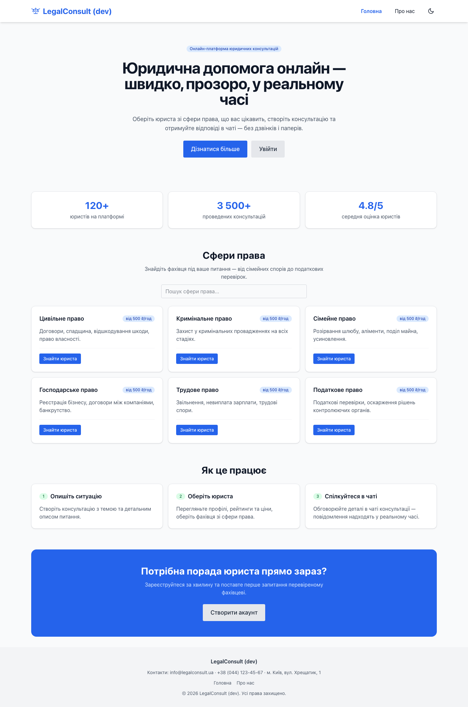
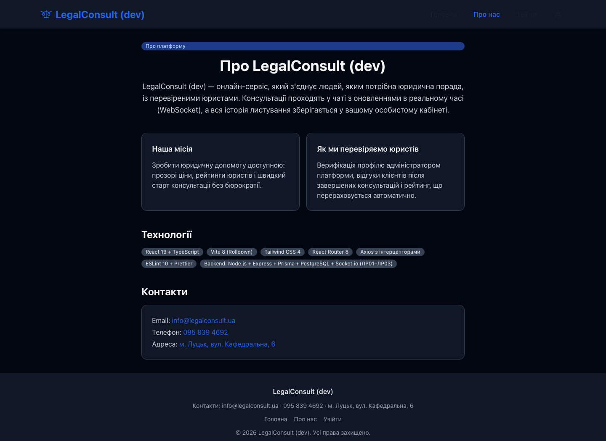
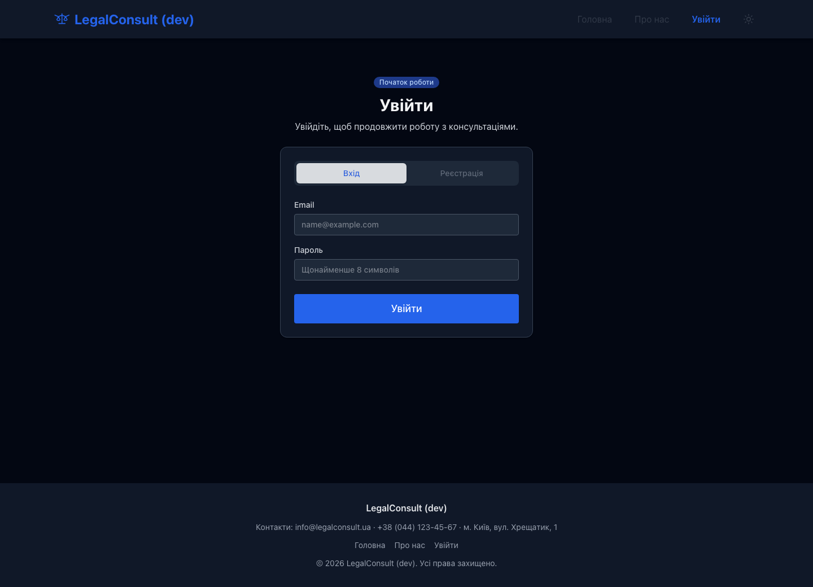

# LegalConsult — клієнтська частина (ЛР04)

## Автор

Чернік Михайло Богданович, група ІПЗ-41

## Опис проєкту

React-клієнт для **онлайн-платформи юридичних консультацій**. Серверна частина розміщена в окремому репозиторії `legal-consult-api-lr03` (Node.js + Express + Prisma + PostgreSQL + Socket.io).

У цій лабораторній я побудував основу клієнтської частини: налаштував проєкт, структуру папок, дизайн-систему, маршрутизацію, dark-режим та інтеграційний шар для API. Також додав мінімальну робочу сторінку входу / реєстрації: вона використовує реальні Axios-сервіси, після успішної відповіді сервера зберігає JWT-токени та показує стан завантаження або помилку. Особистий кабінет, каталог юристів із серверними даними й чат планую розвивати у наступних лабораторних.

## Що я реалізував

| Напрям | Результат |
|---|---|
| Основа | Vite 8, React 19, TypeScript 6, абсолютні імпорти `@/` |
| UI | Button, Input, Card, Badge, Loading, ErrorBoundary; єдина Layout-оболонка |
| Навігація | Home, About, Login/Register, 404; desktop і mobile-меню |
| Стилізація | Tailwind CSS 4, власна палітра через `@theme`, світла й темна теми |
| API | Axios instance, JWT request-interceptor, 401 response-interceptor, типізовані auth/specializations-сервіси |
| Якість | ESLint 10, Prettier, strict TypeScript, CI на GitHub Actions |

## Технології

- React 19 + TypeScript 6
- Vite 8 (Rolldown)
- Tailwind CSS 4 (налаштування в CSS через `@theme`, без `tailwind.config.js`)
- React Router 8 (імпорти з пакета `react-router`)
- Axios з інтерцепторами
- ESLint 10 (flat config) + Prettier + eslint-config-prettier

## Встановлення та запуск

### Вимоги

- Node.js 24 LTS (`node -v`)
- npm
- запущена серверна частина з ЛР03 на `http://localhost:3000` (для API-запитів)

### Інструкції

```bash
# Клонування репозиторію
git clone https://github.com/mishachernika/legal-consult-client-lr04.git
cd legal-consult-client-lr04

# Встановлення залежностей
npm install

# Копіювання .env файлу (VITE_API_URL, VITE_APP_NAME)
cp .env.example .env

# Перевірки якості коду
npm run lint           # ESLint
npm run format:check   # Prettier (перевірка)
npm run format         # Prettier (автоформатування src)

# Запуск у режимі розробки (http://localhost:5173)
npm run dev

# Збірка для продакшену (typecheck + бандл у dist/)
npm run build

# Перегляд продакшен-збірки
npm run preview        # http://localhost:4173
```

### Змінні середовища

Vite віддає в код лише змінні з префіксом `VITE_` — тому в них **не можна** зберігати секрети ( вони потрапляють у фінальний бандл, який бачить будь-хто). Локальний `.env` додано до `.gitignore`.

| Файл | Призначення |
|---|---|
| `.env` | локальний, не комітиться (див. `.gitignore`) |
| `.env.example` | шаблон зі змінними без реальних значень |
| `.env.development` | `npm run dev` — `VITE_API_URL=http://localhost:3000/api` |
| `.env.production` | `npm run build` — адреса продакшен-API |

## Структура проєкту

```
src/
├── components/      # Повторно використовувані UI-компоненти
│   ├── common/      # Button, Input, Card, Badge, Loading, ErrorBoundary
│   └── layout/      # Header, Footer, Layout
├── pages/           # Сторінки маршрутів (Home, About, NotFound)
├── services/        # Axios-інстанс з інтерцепторами + API-сервіси (auth, specializations)
├── types/           # Типи відповідей API (api.types.ts, auth.types.ts)
├── utils/           # format.ts (дата/ціна/розмір), cn.ts (класи Tailwind)
├── hooks/           # useTheme (світла/темна тема)
└── constants/       # APP_NAME, ROUTES, STORAGE_KEYS, CONTACTS, підписи enum'ів
```

Абсолютні імпорти через псевдонім `@/` налаштовано і в `tsconfig.app.json` (`paths`), і у `vite.config.ts` (`resolve.alias`).

## Маршрути

| Шлях | Сторінка |
|---|---|
| `/` | HomePage — hero, статистика, каталог сфер права з пошуком, кроки роботи |
| `/about` | AboutPage — про платформу, технології, контакти |
| `/login` | AuthPage — вкладки входу/реєстрації, стани loading/error, збереження JWT після успішної відповіді |
| `*` | NotFoundPage — 404 |

## Приклади інтерфейсу

### Головна сторінка



Головна демонструє адаптивну сітку, reusable-компоненти, пошук сфер права на клієнті та CTA-блок.

### Сторінка «Про платформу»



На цій сторінці я зібрав короткий опис сервісу, пояснення моделі перевірки юристів, стек технологій і реальні контактні дані.

### Адаптивний вигляд


Для малого екрана макет переходить в одну колонку: картки статистики та сфери права не стискаються, а навігація змінюється на мобільне меню.

### Вхід і реєстрація



Сторінка працює з `authService`: після успішного входу або реєстрації зберігає access/refresh токени, а помилки API показує користувачу в доступному `role="alert"` блоці.

### Інші перевірені стани

| Файл | Що на скріншоті |
|---|---|
| `reports/screenshots/lab4-home-light.png` | Головна сторінка, світла тема (desktop 1440px) |
| `reports/screenshots/lab4-home-dark.png` | Головна сторінка, темна тема (клас `dark` на `<html>`) |
| `reports/screenshots/lab4-about.png` | Сторінка «Про нас» |
| `reports/screenshots/lab4-notfound.png` | Сторінка 404 |
| `reports/screenshots/lab4-home-mobile.png` | Адаптивна мобільна версія (390px, бургер-меню) |
| `reports/screenshots/lab4-home-mobile-dark.png` | Мобільна версія, темна тема |
| `reports/screenshots/lab4-terminal-lint.png` | `npm run lint` + `npm run format:check` у Terminal |
| `reports/screenshots/lab4-terminal-build.png` | `npm run build` (tsc -b && vite build) у Terminal |
| `reports/screenshots/lab4-terminal-dev.png` | `npm run dev` — Vite піднявся на http://localhost:5173 |

## Як я організував проєкт

- `Layout` поєднує Header, Footer, `Outlet` і `ErrorBoundary`, тому всі маршрути мають єдиний каркас і захист від помилок рендерингу.
- `src/services/api.ts` залишив єдиним місцем конфігурації HTTP: base URL з `VITE_API_URL`, timeout, Bearer-токен і нормалізація помилок.
- У `src/types/` описав контракт із сервером ЛР01–ЛР03; Decimal-поля передаються рядками, а для пагінації використовую generic-тип `PaginatedResponse<T>`.
- `useTheme` зберігає вибір у `localStorage`, синхронізує клас `dark` на `<html>` і має fallback на системну тему.
- Усі базові компоненти мають типізовані props; зокрема, `Button` підтримує variant, size і loading-стан без дублювання стилів.

## CI

`.github/workflows/ci.yml` — на кожен push у `main`: `npm ci` → `npm run lint` → `npm run format:check` → `npm run build` (Node 24).
